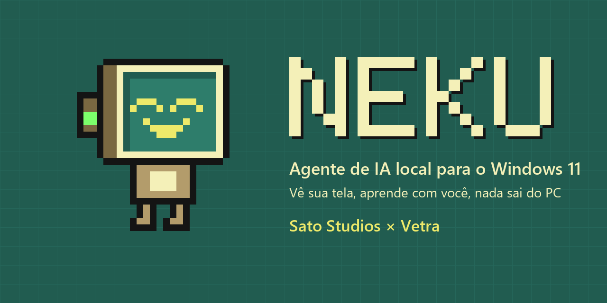
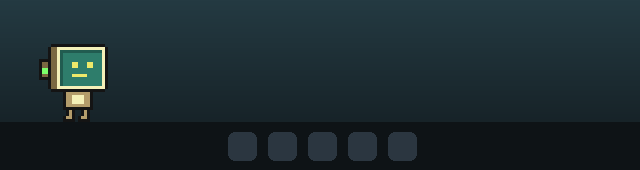
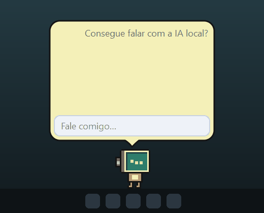
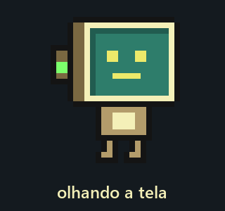
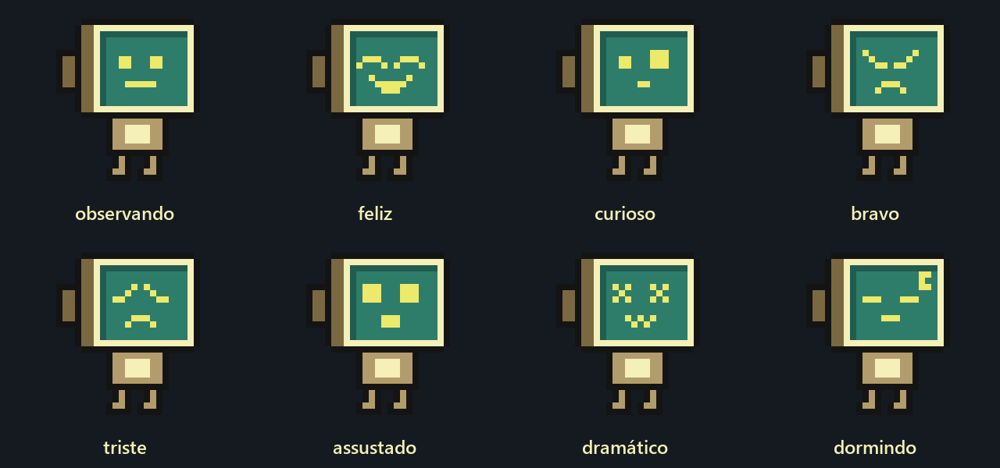
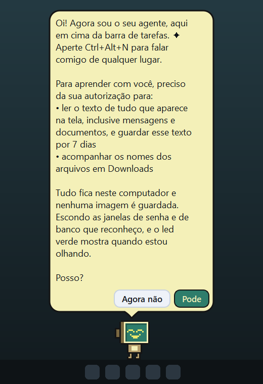
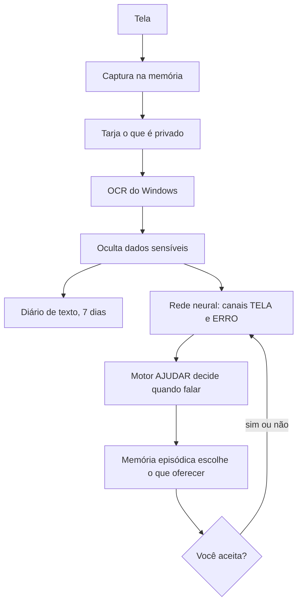

<p align="center">
  
</p>

<p align="center">
  <a href="LICENSE"></a>
  
  
  
</p>

O **Neku** é um agente de IA que mora em cima da sua barra de tarefas. Ele lê o que aparece na tela, aprende com a sua rotina e faz tarefas no computador quando você pede. Tudo roda na sua máquina: sem conta, sem nuvem, sem assinatura.

É uma parceria da **Sato Studios** com a **Vetra**, de código aberto, para qualquer pessoa estudar, usar e melhorar. Parte do código vem do projeto [Pestinha](https://github.com/mille-okws/pestinha), de mille-okws, que dá ao Neku o corpo e a rede neural.

<p align="center">
  
</p>

## O que ele faz

**Vê a sua tela.** Com a sua autorização, lê o texto visível com o OCR do próprio Windows. Você pode perguntar o que tem na tela, pedir um resumo ou procurar algo que viu ontem.

**Aprende com você.** Percebe quais programas costumam vir um depois do outro, quais assuntos se repetem e como você escreve. O que ele nota vira hipótese, nunca fato. Cada sim ou não seu ajusta quando ele deve oferecer ajuda.

**Faz tarefas.** Abre programas e pastas, organiza Downloads, descompacta `.zip`, verifica arquivos com o Microsoft Defender, cria avisos e guarda lembretes. Só existe o que está no catálogo: não há comando livre de terminal.

**Tem um cérebro de verdade.** Quando falar é decidido por uma rede neural pulsada de 492 neurônios, com emoções e sono próprios. O led lateral mostra se ele está olhando.

<p align="center">
  
  
</p>

<p align="center">
  
</p>

## Instalação

Você precisa do Windows 11 e do Python 3.11 ou mais novo, de 64 bits. A internet só é usada na instalação.

```powershell
git clone https://github.com/satostudios/Neku.git
```

1. Deixe a pasta em um lugar permanente. Se movê-la depois, instale de novo.
2. Dê dois cliques em `scripts\install.bat`.
3. Abra pelo atalho **Neku** da Área de Trabalho.
4. Recomendado: rode `scripts\instalar_modelo.bat` para baixar o modelo de conversa (cerca de 240 MB, com SHA-256 conferido) e reabra o Neku. O modelo tem licença própria, a LFM Open License v1.0.

## Como usar

- **Ctrl+Alt+N** ou dois cliques no Neku: abre a conversa. **Esc** fecha.
- **Botão direito** no Neku ou na bandeja: menu.
- **Arraste** para mover. Ao soltar, ele volta para a barra.
- **Ctrl+Alt+Shift+B**: pânico. Desliga tudo na hora, até você religar.

| Você diz | O que acontece |
|---|---|
| "o que você está vendo?", "resume a tela" | Conta o que há na tela |
| "procura orçamento na tela" | Procura no que está visível |
| "onde eu vi o contrato?", "o que eu estava fazendo às 15h?" | Consulta o diário da tela |
| "o que você aprendeu?" | Mostra os assuntos do seu dia a dia |
| "para de olhar", "volta a olhar" | Pausa e retoma a visão |
| "apaga o que você viu" | Apaga o diário, com confirmação |
| "abre o bloco de notas", "abre a pasta downloads" | Abre apps do Menu Iniciar e pastas |
| "descompacta o último zip", "verifica se foto.zip tem vírus" | Usa o Microsoft Defender |
| "organiza meus downloads", "desfaz a organização" | Separa em subpastas e desfaz |
| "move relatorio.pdf para documentos" | Mexe em arquivos, com confirmação |
| "como está o pc?", "me avisa em 10 minutos" | Sistema e avisos |
| "lembre que prefiro chá", "esquece o café" | Guarda e apaga memórias |
| "consegue falar com a IA local?" | Testa o modelo de verdade e diz o resultado |

## Privacidade

**Leia antes de autorizar.** Com a visão ligada, o Neku lê a cada poucos segundos o texto de todos os monitores, inclusive mensagens e documentos abertos, e guarda esse texto no seu computador por 7 dias.

<p align="center">
  
</p>

- Nada sai do computador. O OCR é o do Windows e o modelo só fala com `127.0.0.1`.
- Nenhuma imagem é gravada. A captura fica na memória até o texto ser lido.
- Gerenciadores de senha, telas de login, bancos e navegação anônima são tarjados antes do OCR.
- CPF, CNPJ, cartões, senhas digitadas e chaves de API são ocultados antes de guardar.
- A visão pausa quando você se afasta, em jogos e quando ele dorme.
- Teclas e área de transferência nunca são capturadas.

**O filtro tem limites.** Ele trabalha com listas e padrões, então um banco com nome desconhecido ou um dado em formato incomum pode passar. Coloque janelas delicadas em **Títulos ignorados**. O diário é texto simples: quem usa a sua conta do Windows, ou um programa rodando nela, consegue ler `data/tela/`.

Estas regras não mudam com nenhuma configuração:

- Texto da tela nunca vira comando. Só o que você digita aciona ações.
- O modelo não executa ações nem grava memórias.
- Criar, mover e mandar para a Lixeira sempre pedem confirmação. Nada é apagado de forma definitiva.
- Arquivos só são alterados nas suas pastas pessoais.

## Como funciona



O Neku é feito em Python com PySide6. O motor do Pestinha cuida da rede neural, das emoções e da física do corpo. A conversa usa o `llama.cpp` com um modelo pequeno, ligado só quando precisa e desligado quando fica ocioso.

## Consumo

Medido em um Intel i5-1235U com 16 GB de RAM:

| Situação | RAM | CPU |
|---|---|---|
| Neku | 134 a 176 MB | 0,4% do total com a máquina calma |
| Servidor do modelo, só ao conversar | 443 a 474 MB | 3,8 núcleos enquanto responde |
| Total conversando | cerca de 580 a 620 MB | |

## Limites conhecidos

- **O modelo é fraco.** Ele é leve, mas inventa detalhes e erra contas. Acertou 20 de 30 perguntas simples de conhecimento, então não use as respostas dele como fonte. Comandos e ações não dependem do modelo.
- O OCR lê texto, não imagens: ele não descreve uma foto nem entende um gráfico.
- Os pedidos são entendidos por regras, então frases muito diferentes dos exemplos podem não funcionar.
- Só `.zip` é descompactado.
- Pouco testado com vários monitores e com a barra de tarefas no topo ou nas laterais.
- Funciona só no Windows 11.

## Contribua

O projeto é aberto a melhorias. Veja [CONTRIBUTING.md](CONTRIBUTING.md) para rodar os testes e ver por onde começar. Falhas de segurança seguem o [SECURITY.md](SECURITY.md).

## Créditos

- **[Sato Studios](https://github.com/satostudios) e Vetra:** criação do Neku.
- **[Pestinha](https://github.com/mille-okws/pestinha), de mille-okws:** motor com rede neural pulsada, emoções, física e comportamentos. Veja o que veio de lá e o que mudou em [NOTICE.md](NOTICE.md).
- **[llama.cpp](https://github.com/ggml-org/llama.cpp):** servidor local do modelo.
- **LFM2.5-350M, da Liquid AI:** modelo de conversa, baixado à parte.
- **[PySide6](https://doc.qt.io/qtforpython-6/):** interface.

## Licença

O Neku é distribuído sob a [GPL-3.0-or-later](LICENSE), porque incorpora o motor do Pestinha. Você pode usar, estudar, alterar e redistribuir, desde que versões distribuídas continuem abertas sob a mesma licença. O modelo opcional tem licença própria.

## In English

Neku is a local AI agent for Windows 11 that lives on top of your taskbar. It reads your screen with the built-in Windows OCR, learns from your routine and runs tasks on request, with nothing leaving your computer. It is a partnership between Sato Studios and Vetra, released under GPL-3.0-or-later and built on the [Pestinha](https://github.com/mille-okws/pestinha) engine by mille-okws.
